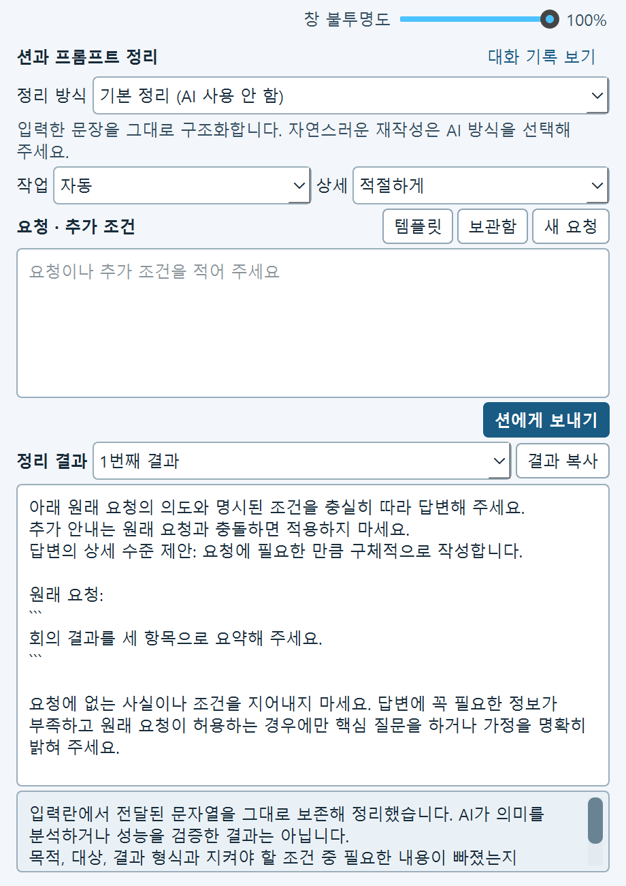
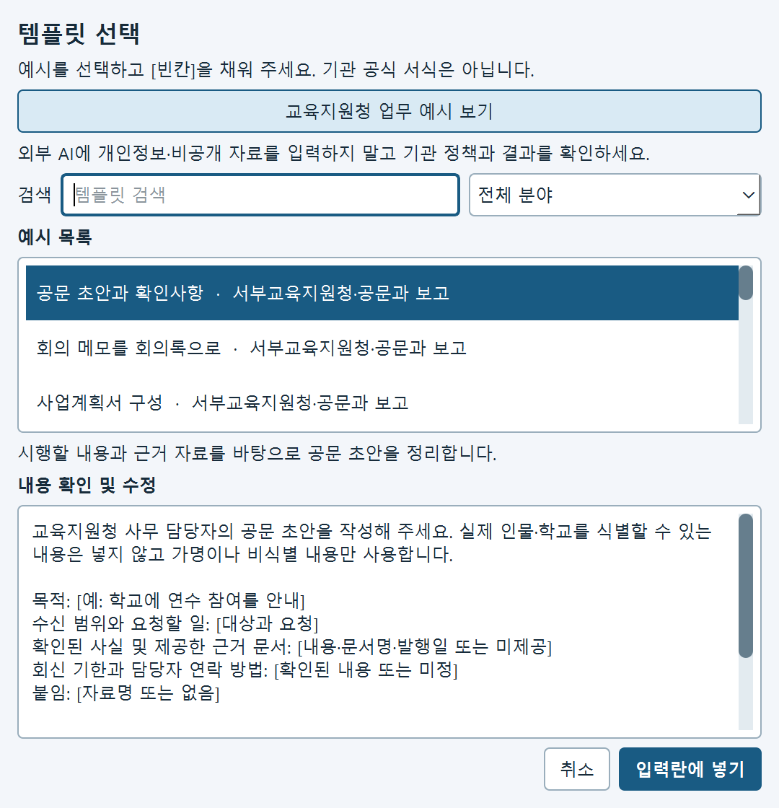

  
  <h1>션과 함께, 프롬프트를 차근차근</h1>
  
<strong>SyeonPet · Windows 데스크톱 펫 &amp; 프롬프트 정리 도우미</strong>

  
바탕화면에서 만나는 션에게 원하는 일을 이야기하고, 정리된 요청을 직접 살펴보고 고쳐서 복사해 보세요.

[Windows 다운로드](https://github.com/Logic-k/SyeonPet/releases/latest) · [사용 가이드 HTML](docs/유초등교육과_션_사용가이드.html) · [사용 가이드 PDF](docs/유초등교육과_션_사용가이드.pdf) · [기능과 데이터 안내](docs/PROMPT_TOOLKIT_INTEGRATION.md) · [배포 안내](docs/RELEASE_GUIDE.md)

---

## 어떤 일을 도와주나요?

션은 바탕화면을 걸어 다니는 펫이자 **프롬프트를 작성하고 검토하는 작은 작업 공간**입니다. 막연한 요청을 입력하거나 업무 예시를 골라 내용을 채우고, 정리된 결과를 직접 수정한 뒤 원하는 곳에 복사할 수 있습니다.

| | 이렇게 활용할 수 있어요 |
|---|---|
| **요청 정리** | 회의 메모를 정리할 방법, 안내문 초안의 조건처럼 원하는 일을 입력해 요청의 구조를 잡습니다. |
| **업무 예시** | 공문·회의·학교 지원 등 교육지원청 업무 예시와 일반 템플릿을 선택하고 빈칸을 직접 채웁니다. |
| **검토와 수정** | 결과를 바로 편집하고, 추가 조건을 이어 붙이거나 이전 결과를 선택한 뒤 복사합니다. |
| **보관과 백업** | 필요한 작업만 로컬 보관함에 저장하고 JSON으로 백업하거나 가져옵니다. |
| **션과 함께** | 걷고, 인사하고, 춤추는 션을 만나고 요청 처리 중에는 고민하는 모습을 볼 수 있습니다. |
| **션이 옷장** | 미리 준비된 의상과 소품을 골라 션을 꾸미고 언제든 기본 모습으로 돌아갑니다. |

> **처음 열면 Vireonix AI가 선택되어 있습니다.** 요청을 보내고 전송 확인창에서 동의해야 외부 AI 호출이 시작됩니다. 외부에 보내지 않으려면 정리 방식에서 `기본 정리 (AI 사용 안 함)`을 직접 선택하세요. 기본 정리는 입력을 구조화하는 오프라인 기능이며 AI가 내용을 다시 쓰거나 품질을 검증하지 않습니다.

## 화면 미리보기

<table>
  <tr>
    <td align="center"><strong>션과 프롬프트 정리</strong></td>
    <td align="center"><strong>업무 템플릿 선택</strong></td>
  </tr>
  <tr>
    <td></td>
    <td></td>
  </tr>
</table>

*화면은 테스트용 예시로 촬영한 실제 Qt 대화창입니다. 대화창 그림은 오프라인 방식을 선택한 모습이며, 새 대화창에서는 Vireonix가 먼저 선택됩니다. 기관의 실제 문서나 개인정보는 포함하지 않았습니다.*

## 빠르게 시작하기

1. [릴리스 페이지](https://github.com/Logic-k/SyeonPet/releases/latest)의 **Assets**에서 `SyeonPet-버전-windows.zip`을 받습니다. `.sha256`은 파일 확인용 체크섬입니다.
2. ZIP을 **새 폴더**에 압축 해제하고 폴더 안의 SyeonPet.exe를 실행합니다. 실행 파일과 Python·Qt 런타임, 소스, assets는 같은 폴더에 함께 있어야 합니다.
3. 션의 몸을 우클릭하거나 Windows 알림 영역의 션 아이콘 메뉴에서 **프롬프트 정리 열기**를 선택합니다.
4. 정리 방식을 확인합니다. 기본 선택인 **AI 정리 · Vireonix**를 사용하거나, 외부 AI 없이 정리하려면 `기본 정리 (AI 사용 안 함)`을 선택합니다.
5. 입력란의 연한 업무 예시를 참고해 요청을 직접 쓰거나 **템플릿**을 선택한 뒤 **션에게 보내기**를 누릅니다. 예시는 자동으로 입력되거나 전송되지 않습니다. AI를 선택했다면 전송할 내용과 서비스 안내를 읽고 동의해야 요청이 전송됩니다. 동의하지 않으면 취소하거나 기본 정리를 선택하세요.
6. 정리 결과를 읽고 수정한 다음 **결과 복사**를 누릅니다. 실제 업무에 사용하기 전 원래 의도와 조건을 확인하세요.

처음 쓰신다면 [유초등교육과 사용 가이드 HTML](docs/유초등교육과_션_사용가이드.html)을 내려받아 브라우저에서 열거나, [PDF 인쇄본](docs/유초등교육과_션_사용가이드.pdf)을 확인해 보세요. 따라 할 순서와 업무 예시를 담았습니다. 부서에 공유하거나 인쇄할 때는 페이지 나눔을 확인한 PDF를 이용하세요. GitHub에서는 HTML이 소스 형태로 보일 수 있으므로 파일을 내려받아 여는 방법을 권합니다.

**v0.1.5 이하를 사용 중이라면:** 자동 업데이트 기능이 있는 버전으로 처음 옮길 때는 새 ZIP을 한 번 직접 받아 **다른 폴더**에 풀어야 합니다. 먼저 필요한 대화는 **보관함 → 현재 작업 저장**을 선택하거나 결과를 복사하고, 보관함을 JSON으로 백업한 뒤 앱을 종료하세요. JSON에는 보관함에 저장한 항목만 포함됩니다. 기존 폴더에 덮어쓰면 `config.json` 설정이 바뀔 수 있으며, 새 폴더로 개인 설정은 자동 이전되지 않습니다. [설정과 보관함 보존 방법](docs/RELEASE_GUIDE.md)

배포 실행 파일은 디지털 서명되지 않아 Windows에서 경고가 표시될 수 있습니다. 공식 릴리스와 SHA-256을 확인하고 기관의 설치 정책에 따라 진행하세요. 체크섬은 파일 일치 여부를 확인하며 작성자 신원을 단독으로 증명하지는 않습니다.

## 업무에서 이렇게 시작해 보세요

실제 업무 정보 대신 가상의 내용을 넣고 연습해 볼 수 있습니다.

    유초등교육과 회의 내용을 세 항목으로 요약하는 요청을 작성해 주세요.
    대상은 담당자이며, 결정 사항과 후속 확인 사항을 구분해 주세요.
    확인되지 않은 내용은 임의로 채우지 말아 주세요.

**템플릿 → 교육지원청 업무 예시 보기**에서 필요한 예시를 고르고 [빈칸]을 채워도 좋습니다. 제공되는 예시는 공개자료를 참고한 **독립적인 작성 예시**이며, 기관의 공식 서식이나 승인된 AI 서비스를 뜻하지 않습니다. 실제 업무에 사용할 때는 해당 업무 지침과 결과를 확인하세요. [업무 예시 조사 근거](docs/RESEARCH_EDUCATION_MOTION.md)

## 정보는 어떻게 처리되나요?

- **AI 정리:** 새 대화창에는 Vireonix가 미리 선택됩니다. Pollinations Classic도 선택할 수 있습니다. 어느 서비스든 사용자가 보내기를 누르고 매번 전송을 확인한 경우에만 원문·추가 조건·이전 결과가 해당 서비스로 전달됩니다. 확인 전에는 AI 요청이 전송되지 않으며, 서비스 가용성과 결과 품질은 달라질 수 있습니다. AI 결과의 [대괄호] 칸은 알맞은 내용으로 채워 쓰세요. 결과에서 원문의 숫자·따옴표 문구·붙여 넣은 자료가 빠지면 원래 요청이나 자료가 결과 끝에 원문 그대로 붙습니다.
- **기본 정리 (AI 사용 안 함):** 정리 방식 목록에서 직접 선택하면 프롬프트를 외부 AI에 보내지 않고 구조화합니다. 앱은 시작 시 새 버전 확인을 위해 별도로 GitHub 연결을 시도할 수 있습니다.
- **보관함:** 명시적으로 저장한 작업만 션의 로컬 보관함에 저장합니다. 내보낸 JSON에는 원문과 결과가 포함되므로 보관 위치를 주의해서 선택하세요. 기존 프롬프트 툴킷의 보관함은 별도이며 자동 이전되지 않습니다.
- **션이 옷장:** 미리 준비된 의상과 소품을 기기에서 선택합니다. 옷을 고를 때 이미지 생성 서비스에 요청하거나 별도의 계정에 로그인할 필요가 없습니다.
- **업무 자료:** 학생·학부모·직원 식별정보, 민원 원문, 비공개 문서는 외부 전송 전에 기관 정책과 허용된 서비스를 확인하세요. 가상의 내용이나 제공이 허용된 자료로 먼저 연습해 보세요.

## 션과 지내기

| 동작 | 사용 방법 |
|---|---|
| 인사와 반응 | 션을 클릭하거나 더블 클릭해 반응을 확인합니다. |
| 이동 | 션을 끌어 원하는 곳에 놓습니다. 놓으면 낙하하고 착지합니다. |
| 메뉴 | 션을 우클릭하거나 트레이 아이콘을 사용해 걷기·춤·점프·수면과 대화창을 선택합니다. |
| 션이 옷장 | 션 우클릭 또는 트레이 메뉴에서 **션이 옷장**을 열고 의상이나 소품을 선택합니다. 선택한 모습이 바로 적용되며 기본 모습으로 되돌릴 수 있습니다. |
| 수면과 깨우기 | 완전히 잠든 동안 새 요청이 중지됩니다. 션을 클릭하거나 대화창에서 션 깨우기를 누르면 이어갈 수 있습니다. |
| 클릭 통과 | 펫의 빈 공간은 클릭을 통과시킵니다. 전체 클릭 통과를 켠 경우 트레이 메뉴에서 해제할 수 있습니다. |
| 보기 조절 | 대화창의 불투명도를 60~100%로 조절합니다. 100%에서 가장 선명하며 반투명일 때는 뒤의 화면에 따라 가독성이 달라집니다. |

신규 사용자 온보딩, 여러 모니터의 작업 영역 인식, 프레임 부드러운 전환과 Windows 시작 시 자동 실행도 지원합니다. 온보딩·동작과 자동 실행은 트레이에서 조절할 수 있습니다.

**션이 옷장**에서 미리 준비된 의상과 소품을 선택하면 션에게 바로 적용됩니다. 별 베레모, 해바라기 모자, 분홍 리본 모자, 하늘·분홍 목도리, 하늘 가디건, 노란 앞치마가 준비되어 있습니다. 별도의 이미지 생성, 계정 로그인이나 인터넷 연결 없이 선택할 수 있으며, **기본 모습**을 고르면 장식을 해제할 수 있습니다. 모자를 쓰는 동안 머리의 잎은 모자 속에 감춰지며, 기본 모습으로 돌아오면 다시 보입니다.

옷장 위쪽의 **옷 빠른 선택**이나 아래쪽 목록에서 원하는 모습을 선택할 수 있습니다. **움직임 미리보기**에서는 서기, 걷기, 끌려가기, 잠자기와 고민 등 해당 외형이 지원하는 동작을 살펴볼 수 있습니다. **재생**과 **일시정지**, 프레임 슬라이더와 **좌우 반전**을 이용하며, 미리보기를 바꾸어도 실제 펫의 현재 동작은 바뀌지 않습니다. 선택한 의상은 기존과 같이 바로 적용됩니다. 자세에 따라 몸통 옷 일부가 가려질 수 있으므로 원하는 모습을 직접 확인해 주세요.

기존 외형 파일과 가져온 팩은 덮어쓰지 않으며, 옷장에서는 기본 외형과 기본 장식을 각각 선택해 되돌릴 수 있습니다. 완성된 로컬 스프라이트 팩은 옷장의 **가져오기**에서 선택합니다. 형식 검사를 통과해도 자세별 모습은 직접 확인해야 합니다. [외형 팩 형식과 검수 안내](docs/SPRITE_WARDROBE.md)

## 업데이트와 실행 구조

자동 업데이트를 지원하는 버전은 시작 시 공식 GitHub의 새 릴리스를 확인하고, 신뢰할 수 있는 서명과 파일을 검증한 뒤 별도 폴더에 미리 내려받습니다. 트레이 또는 션 메뉴의 **업데이트 확인**으로도 확인할 수 있습니다. 준비가 끝나면 션을 종료하고 다시 실행할 때 적용을 시도합니다. 여러 션을 켜 두었다면 모두 종료해야 합니다.

트레이 또는 션 메뉴의 **종료**를 선택할 때 업데이트가 준비되어 있으면 작성 중인 대화와 템플릿 초안을 복원용 파일에 보관합니다. AI 요청이 진행 중이거나 보관함·확인 창을 사용 중이면 작업이 끝날 때까지 종료를 보류합니다. 실행에 실패하면 기존 설치나 이전 버전으로 돌아가도록 설계되어 있으며 복원용 초안 파일을 남깁니다. 복원 원본에는 민감한 대화 내용이 암호화되지 않은 텍스트로 남을 수 있습니다. Windows 종료나 프로세스 강제 종료까지 모든 작업의 복원을 보장하는 기능은 아니므로 중요한 작업은 보관함에 저장하고 JSON을 따로 백업하세요. 인터넷이나 검증에 문제가 있으면 설치된 버전을 계속 사용할 수 있습니다.

여러 션의 초안은 각각 보관되고 다시 실행한 창마다 하나씩 복원됩니다. 모든 창이 자동으로 함께 열리지는 않으므로 여러 초안을 확인하려면 션을 그만큼 다시 실행하세요.

업데이트 정보의 서명 검증은 실행 파일의 Windows 디지털 서명과 다릅니다. 기존 v0.1.5 이하에는 이 기능이 없어 처음 한 번은 위의 새 폴더 설치가 필요합니다. [업데이트와 데이터 보존 안내](docs/RELEASE_GUIDE.md)

이 앱은 **Python과 PySide6**를 사용합니다. SyeonPet.exe는 같은 폴더의 main.py와 포함된 Python 런타임을 실행하는 런처이며 run.cmd는 대체 실행 방법입니다. 실행 파일 하나만 옮기는 단일 파일 앱이 아니고, Tauri나 WebView2는 필요하지 않습니다.

## 개발자를 위한 안내

    main.py              QApplication, 트레이, 자동 실행과 앱 생명주기
    pet.py               펫 렌더링, 클릭 판정, 드래그와 물리
    behavior.py          걷기·대기·수면·낙하·고민 등 상태 관리
    chat.py              대화창, 불투명도와 종료 확인
    optimizer_*.py       정리, 템플릿, 보관함과 선택형 AI 연결
    update_checker.py    GitHub 릴리스 확인
    updater_*.py         업데이트 검증·준비와 실행 전환
    wardrobe.py          션이 옷장과 액세서리 선택
    wardrobe_presets.py  준비된 의상과 소품의 프레임별 표시
    assets/              션 스프라이트와 템플릿 데이터
    docs/                사용 안내, 리서치와 스프라이트 기록

Windows에서 포함 런타임과 함께 소스를 실행하려면 run.cmd를 사용합니다. 패키지 생성 방법과 저장 데이터에 대한 설명은 [Windows 배포 안내](docs/RELEASE_GUIDE.md)를 참고하세요. 옷의 움직임 검토와 오픈소스 도구 기록은 [옷장 제작·검토 안내](docs/WARDROBE_CURATION.md), 고민 동작의 출처와 후처리 기록은 [THINKING_SPRITE.md](docs/THINKING_SPRITE.md)에 있습니다. 설정 항목에는 display_size, walk_speed, start_onboarding_on_launch, ambient_chatter, ambient_lines, onboarding_steps가 있으며 config.json에서 관리합니다.

션 캐릭터 자산과 제3자 구성 요소의 배포 권리·의무는 독립적으로 모두 확인되지 않았습니다. 사용과 재배포 전 권리를 확인하고, 포함 런타임의 출처와 라이선스는 [제3자 고지](tools/THIRD_PARTY.md)를 참고하세요.
